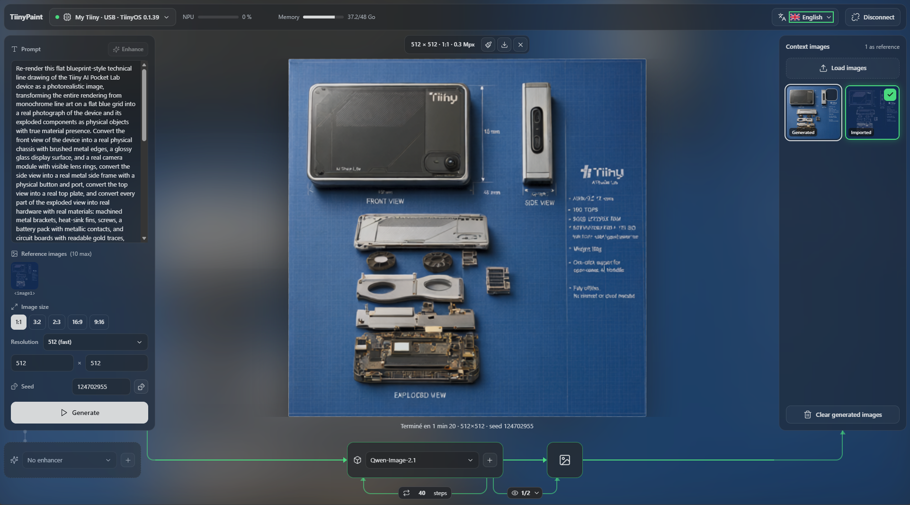

# TiinyPaint

Create and edit images with Qwen-Image 2.1 on the Tiiny AI Pocket Lab. It is a static web page with no backend or build step: the browser talks directly to the Tiiny API.

## Run

Open `web/index.html` in Chrome or Edge (double-click), then enter the Tiiny address (`http://tiinyhost.local` by default on the local network, otherwise `http://` followed by its IP over USB or Wi-Fi) and the API key (TiinyOS → Settings → API Key). The key stays in the browser's `localStorage` and is never written to the repo.

The Tiiny must be unlocked: after a restart, the API returns 502 until TiinyOS has been opened.

You can also use the hosted version at https://mcornier.github.io/TiinyPaint/ with Chrome or Edge. Because that page is served over HTTPS, the browser asks for permission to access your local network the first time it reaches the Tiiny: allow it. Firefox and Safari block this, so open the local file with them.

## Features

- **Creation** and **editing with references** (up to 10 images), using the same Qwen-Image 2.1 weights.
- **Prompt enhancement**: PE-I2I, PE-T2I or any installed LLM, chosen in its own block. The Enhance button rewrites the prompt so you can review and edit it, and Generate always sends the prompt as written.
- **Generation graph**: an animated chain from the prompt panel through the model to the image and the context images, with the enhancer in a separate block. It holds the model choice and the inference settings.
- **Settings**: aspect ratio, resolution, steps, CFG, seed, scheduler, negative prompt, temperature, top P, top K.
- **Preview during diffusion**: Off, 1/8, 1/4, 1/2, 1. It stays blurred on the canvas while rendering, and hovering shows the step as decoded. The Stop button really does stop the computation on the Tiiny.
- **Context images**: load images and generate new ones in one panel, and tick those to use as references. They survive a page reload, and a button clears the generated ones. They are deleted the next time TiinyPaint opens after the tab was closed. Download the images you want to keep.
- **Models**: load and unload, with a check against the NPU's actual memory.
- **Editor**: mask brush, eraser, lasso, rectangle, invert; restore from another image; clone stamp; crop; canvas extension; rotate and flip; undo; zoom.
- **Localized diffusion**: only the masked area is generated, and pixels outside it stay identical.
- **Interface in 5 languages**: English, French, Spanish, German, Italian.

## Structure

| File | Purpose |
|---|---|
| `web/api.js` | Tiiny API client (models, image stream, chat stream) |
| `web/app.js` | Interface and workflows |
| `web/session.js` | Session storage of context images (IndexedDB) |
| `web/icons.js` | Bundled Lucide icons |
| `web/editor.js` | Canvas editor and localized diffusion preparation |
| `web/i18n.js` | Translations |
| `web/prompts.js` | Official PE-I2I and PE-T2I system prompts |
| `docs/API_TIINY.md` | What we learned about the API, with measurements |
| `docs/DISTRIBUTION.md` | Tiiny store, App Farm, on-device or desktop app |

## License

The code is under Apache 2.0, except `web/prompts.js`, which contains Qwen's system prompts under the Qwen research license: **non-commercial use only**. Icons come from Lucide, under the ISC license. See [NOTICE](NOTICE). The Qwen-Image 2.1, PE-I2I and PE-T2I models are not included here and are under the same license: commercial use requires a separate agreement with Qwen.
